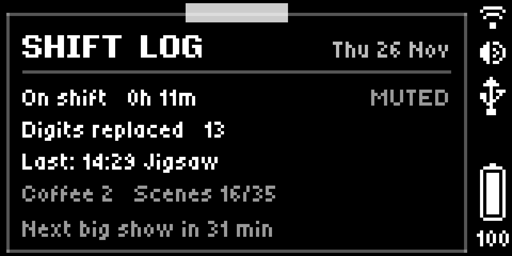

<!-- Made by BUSY Bar Emulator from catalog.json. Edit it freely: once you change it, it is yours and is not made again. -->

# Break Time

A tiny pixel worker lives on your BUSY Bar and changes the clock's digits himself, never the same way twice. Plus a focus timer with breaks.




## How to use

- **Start**: Press: start the focus timer, pause or resume it. Hold: stop it and go back to the clock
- **Wheel turn**: While the timer runs: 5 minutes more or less
- **Wheel press**: Press: poke the worker. Hold: sound on or off
- **Back**: Exit

## Settings

Change them in the BUSY Bar's local web interface.

- **24-hour clock**: Default: on.
- **Focus timer (min)**: Default: 25.
- **Break (min)**: Default: 5.
- **Sound**: Default: Normal.
- **Sleeps at night (23-7)**: Default: on.
- **Background**: Default: Night sky.
- **Garland**: Default: Dec 1 - Jan 14.

## Build and install

```sh
npm ci
npm run build         # dist/app.nortick.break-time.tgz
npm run app:install   # on a BUSY Bar connected over USB
```

Or open the folder in BUSY Bar Emulator and press Refresh.

## License

MIT: see [LICENSE](LICENSE).

Made for [BUSY Bar](https://busy.app).
